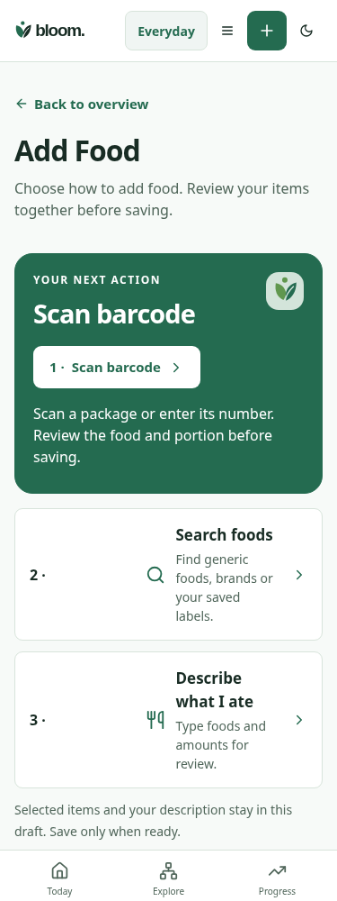

# Add Food master integration — 2026-10-25

Source: actual delivered `design/bloom/archives/Bloom_App_Wide_Experience_Redesign_2026-10-25/add_food.svg`, opened before integration. Baseline c5baf9b9872f27974835ac2cefbdbc4314a86021. The Food Review original was also opened; the existing canonical review remains, not a newly completed redesign.

1. A single prominent barcode action replaces equally weighted choice tiles.
2. Search and description become source-style rows with clear icons, titles and supporting text.
3. Redundant introduction/chooser headings are reduced while the accessible chooser heading, selected-item draft and existing save flow remain.

| Matched state375px | Before | After |
| --- | --- | --- |
| Everyday light | [Original](before/chooser-everyday-light-375.png) | [Original](after/chooser-everyday-light-375.png) |
| Everyday dark | [Original](before/chooser-everyday-dark-375.png) | [Original](after/chooser-everyday-dark-375.png) |
| Athlete light | [Original](before/chooser-athlete-light-375.png) | [Original](after/chooser-athlete-light-375.png) |
| Athlete dark | [Original](before/chooser-athlete-dark-375.png) | [Original](after/chooser-athlete-dark-375.png) |

Actual rendered application with intercepted synthetic provider/storage uses real ProductService, meal analysis and nutrition totals. Twenty chooser combinations (two modes ×five widths320–1440 ×two themes) check reflow; after checks assert one primary action, >=44px control and first-view clearance at320×500. Camera denial/manual fallback, unsupported voice, hidden unfinished methods, Kit Kat synthetic USDA product, description preservation, restaurant context/region keyboard behavior and one canonical cross-method meal save pass. No real provider key/account or geolocation is used.

The conceptual master shows five methods; only three implemented public methods are exposed. Menu search and photo recognition remain gated; restaurant context is manually entered and never claims menu nutrition. Original source assets are preserved. Unchanged review/restaurant panels are tested without new comparison images. Physical Safari/VoiceOver, actual browser zoom, human usability and independent running-build Design approval remain open. This is a partial whole-app v0.5 slice, not final release acceptance.
