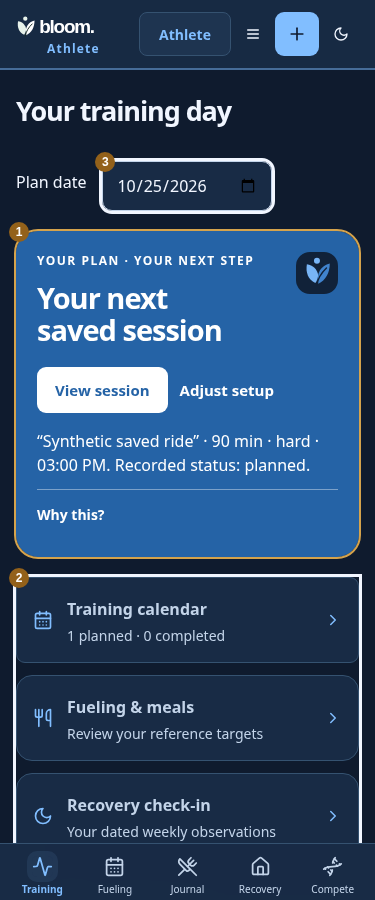

# Athlete Home implementation evidence — 2026-10-25

Adapts the delivered app-wide master `athlete_home.svg` and ARCHITECT_HANDOFF.md in `design/bloom/archives/Bloom_App_Wide_Experience_Redesign_2026-10-25/` to existing calendar, profile, fueling and check-in state. Baseline: b9813d9d51a7ca63e0d0f2d1c5061c572ac72535. No static mockup is used as application UI.

1. One primary session action replaces competing navigation and dense numerical context above the fold.
2. Four source links connect training, fueling, recovery and recorded effort to existing workflows. Reference targets remain available on demand.
3. The selected calendar date is explicit and survives fueling navigation; opening the existing session form seeds that date without replacing edited drafts.

| State | Before | After |
| --- | --- | --- |
| Planned session, 375px | [Original](before/planned-375.png) | [Original](after/planned-375.png) |
| Empty calendar, 375px | [Original](before/empty-375.png) | [Original](after/empty-375.png) |

Actual registered HTTP handlers and browser journeys cover seven states (empty/planned/completed/partial/blocked/delayed/error), six widths (320–1440), and dark mode at375. Separate synthetic accounts preserve real rate limits. Response status is asserted. The actual save journey sends one POST, receives201 and verifies one calendar row and subsequent View session focus. Additional320×500 effective-zoom checks keep the primary action above fixed navigation. Pending/paused/error targets retract; minor gating, explicit zero/source units and unsaved profile/hydration drafts remain protected. Shared Everyday hero regression passed.

Local verification:320 tests, type checks, production build, source crosswalk and actual browser journeys pass. Existing PostCSS warning remains. No authenticated real-user/native/Safari/VoiceOver or human task-success acceptance is claimed.

Remaining: Athlete light/dark palette refinement (current legacy Athlete palette remains dark in both choices), explicit rest/skip source workflows, other master surfaces and independent running-build review. Empty calendars never imply rest or readiness. This is a partial whole-app implementation, not release or clinical approval.
