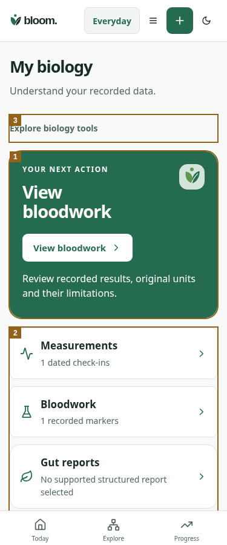

# My Biology source navigation — 2026-10-25

Source: actual delivered `design/bloom/archives/Bloom_App_Wide_Experience_Redesign_2026-10-25/my_biology.svg` opened before integration. Baseline299eda8a977b004cf22d350034b4f62c9d6c5c39. Existing canonical report, editor, consent and source-unit workflows remain.

1. One View bloodwork action replaces the dense six-metric opening panel.
2. Measurements, Bloodwork, Gut reports and Genetics rows show actual source context. Gut reports now opens `/microbiome`; the previous tile incorrectly selected labs.
3. Additional biology tools move into an accessible disclosure on Overview; existing tabs remain visible on detail screens. Goal editing and food preferences remain in their existing canonical controls.

| Matched reported source375 | Before | After |
| --- | --- | --- |
| Everyday light | [Original](before/everyday-reported-light-375.png) | [Original](after/everyday-reported-light-375.png) |
| Athlete dark | [Original](before/athlete-reported-dark-375.png) | [Original](after/athlete-reported-dark-375.png) |
| Empty Everyday | [Original](before/everyday-empty-light-375.png) | [Original](after/everyday-empty-light-375.png) |

Actual precision HTTP handlers with synthetic source storage cover64 combinations: empty/reported/pending-unit/error ×320/375/768/1440 ×light/dark ×Everyday/Athlete. Responses assert200/503; no source-error state is shown as empty. Primary action is >=44px and clears fixed navigation at320×500. Bloodwork action focuses actual saved results; measurement/genetics paths and correct gut-report destination pass. Separate freshness and canonical-unit regressions preserve same-source goal/lab/measurement drafts, explicit0 and original laboratory units.320 tests/types/build/source107 pass.

Only changed overview captures are retained; unit regression artifacts remain temporary. This does not establish native Safari/VoiceOver, actual browser zoom, human task success, independent Design approval or clinical/rights acceptance. The home is source navigation, not a new health score or prioritization model. Whole-app v0.5 remains incomplete.
