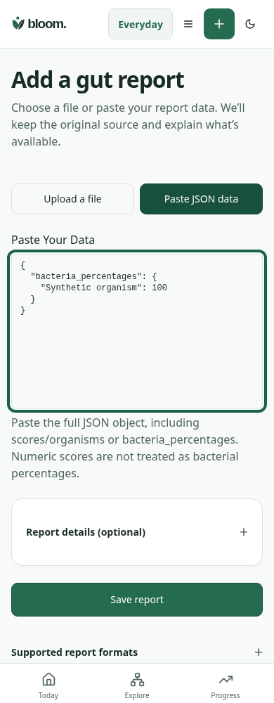
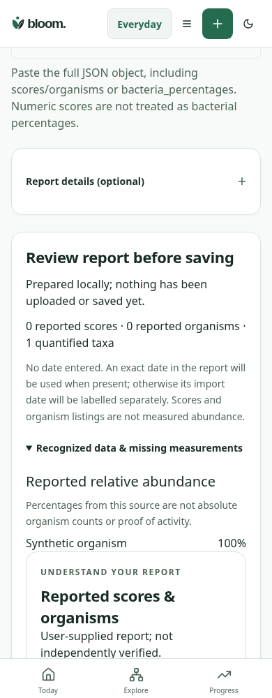

# Gut import: source review before save

Pinned synthetic browser comparison, 390×1000, en-CA/America-Regina. Both runs use the same `Synthetic organism:100%` JSON, mocked authentication/settings, blocked external fonts, zero import writes and zero browser errors. Captures show each action stage in the actual source checkout; no DOM mockup or screenshot restyling. Functional API/PGlite/receipt tests are recorded separately in DEVELOPMENT_LOG.md.

**A — before, 8833cbc7a3d4523a61282e74703563343015a6e7:** the raw JSON editor leads directly to Save report. There is no parsed source-review stage.

**B — after, c60008cea3983f047c100eca396eaf7920e54268:** Review report prepares data locally. The new section distinguishes scores, listed organisms and quantified taxa. The expanded disclosure shows the explicit `Synthetic organism100%` source value, with a relative-abundance limitation. The source can be changed or explicitly saved after review. Native focus brings review into view; the screenshot is the review stage, not the input stage.

Source/viewport/zero-write manifests: before.json and after.json. OS/device, clinical and independent Design/User Testing acceptance remain open.

Reproduce with `node --import tsx scripts/qa/gut-review-comparison.mjs`, the usual BLOOM_PLAYWRIGHT_MODULE/BLOOM_CHROMIUM_EXECUTABLE settings, BLOOM_CAPTURE_STAGE=before|after and BLOOM_CAPTURE_SHA=<full source SHA>. For baseline, BLOOM_CAPTURE_ROOT points to a clean detached checkout of8833cbc with dependencies available. Only temporary worktrees created for this comparison were removed.
