# Bloom v0.5 — nutrition units and Today comparison

Baseline `58f9e63ee732a97b0f6d6f92decf3effa58f31c3`; tested application candidate `a7a984b042f0212f53c018deba88293b12367fcd`. The later evidence-only commit does not change runtime code.

Actual Chromium screenshots using identical synthetic records, fixed time, en-CA locale, America/Regina timezone, 1× pixel density and blocked external fonts. No real accounts or external provider requests. This is a development review package, not full v0.5 brand or independent release acceptance.

Validation: 180 Node tests, 19 Python contracts, TypeScript, production build, existing v0.5 browser regression and new unit/journal-state browser checks passed. Full manifests identify browser, timestamps, viewports, themes, SHA and clean-tree status.

[Baseline manifest](before-manifest.json) · [Candidate manifest](after-manifest.json) · [Code and functional diff](functional-change.diff) · [Current remaining-work ledger](../../architecture/V05_IMPLEMENTATION_STATUS.md)

| Screen / state | Before | After |
| --- | --- | --- |
| today-390-light Saved kJ preference applies: 500 kcal now displays as 2092 kJ; stored intake is unchanged. |  | [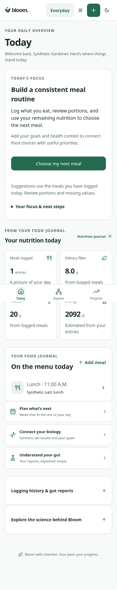](after-today-390-light.png) |
| nutrition-390-light Saved kJ preference applies: 500 kcal now displays as 2092 kJ; stored intake is unchanged. | [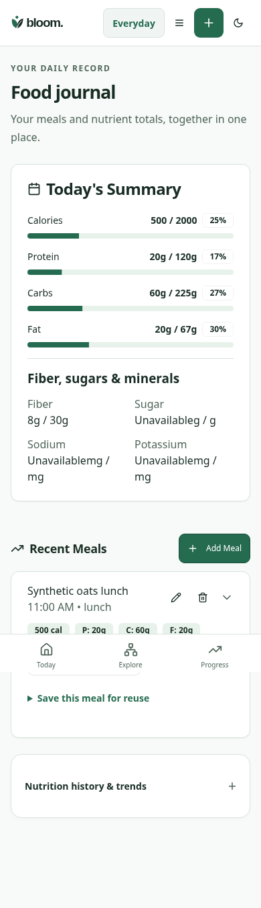](before-nutrition-390-light.png) | [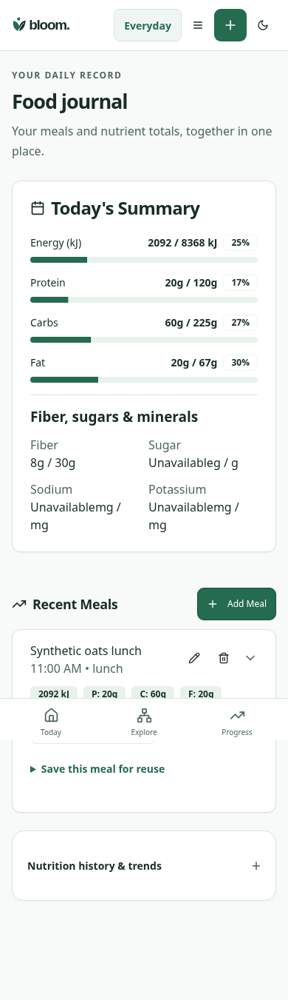](after-nutrition-390-light.png) |
| explore-portion-390-light The same 113.3980925 g portion is entered as 4 oz; source serving facts retain grams. | [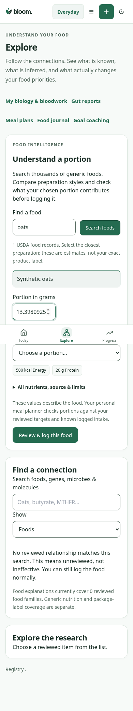](before-explore-portion-390-light.png) | [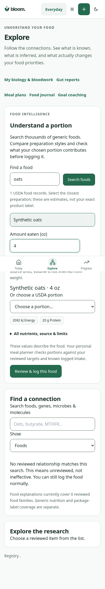](after-explore-portion-390-light.png) |
| today-390-dark Saved kJ preference applies: 500 kcal now displays as 2092 kJ; stored intake is unchanged. | [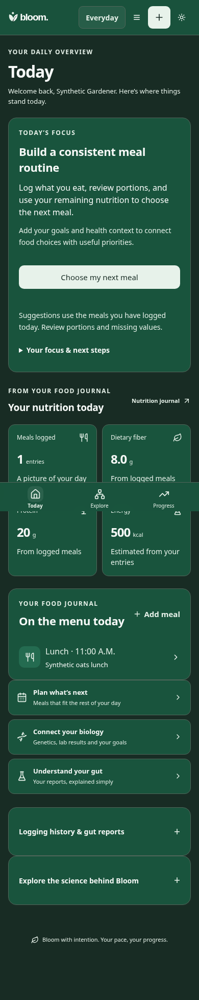](before-today-390-dark.png) | [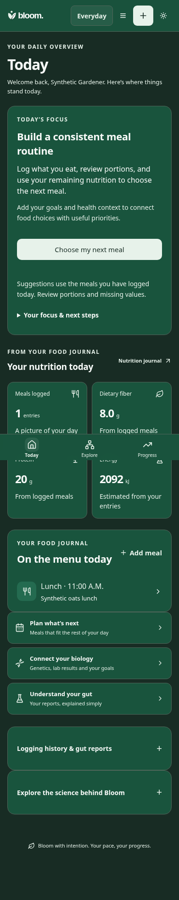](after-today-390-dark.png) |
| nutrition-390-dark Saved kJ preference applies: 500 kcal now displays as 2092 kJ; stored intake is unchanged. | [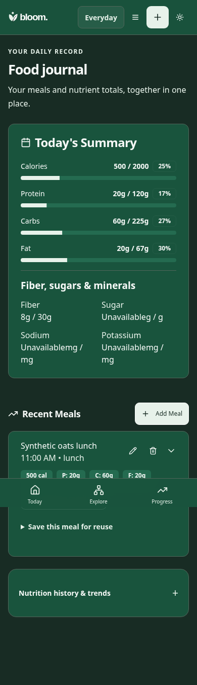](before-nutrition-390-dark.png) |  |
| explore-portion-390-dark The same 113.3980925 g portion is entered as 4 oz; source serving facts retain grams. | [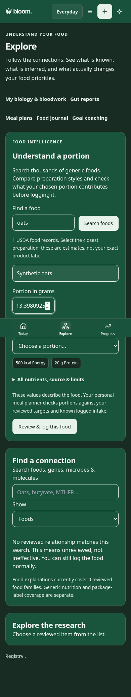](before-explore-portion-390-dark.png) | [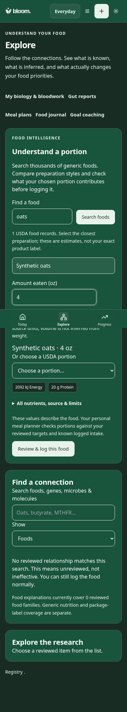](after-explore-portion-390-dark.png) |
| today-1440-light Saved kJ preference applies: 500 kcal now displays as 2092 kJ; stored intake is unchanged. | [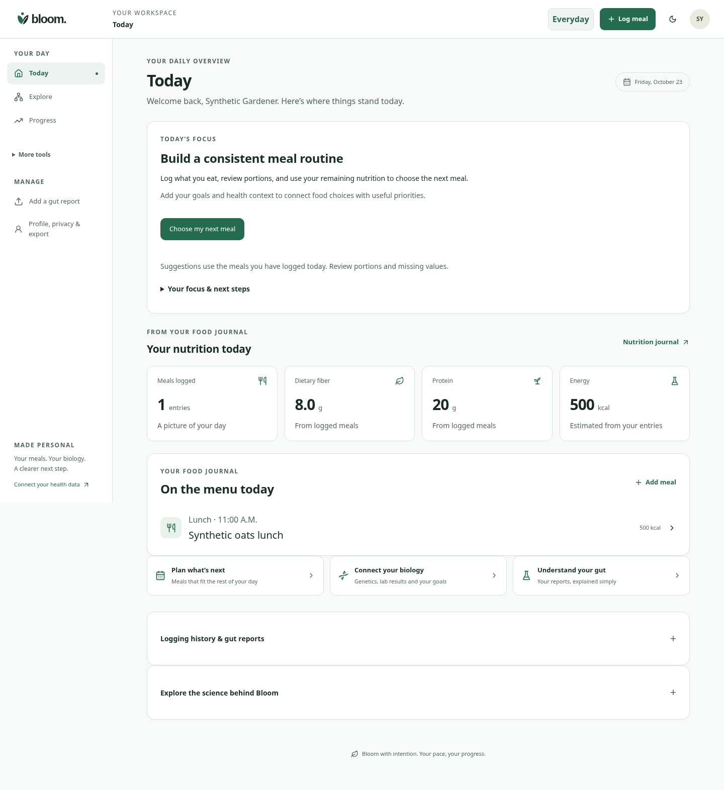](before-today-1440-light.png) |  |
| nutrition-1440-light Saved kJ preference applies: 500 kcal now displays as 2092 kJ; stored intake is unchanged. | [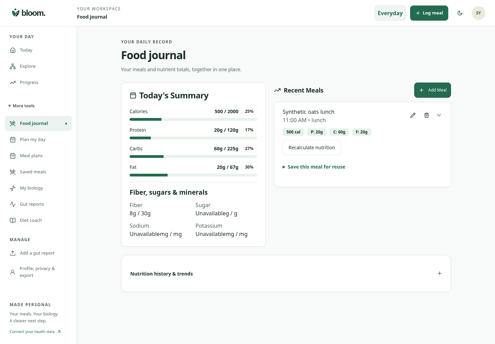](before-nutrition-1440-light.png) |  |
| explore-portion-1440-light The same 113.3980925 g portion is entered as 4 oz; source serving facts retain grams. | [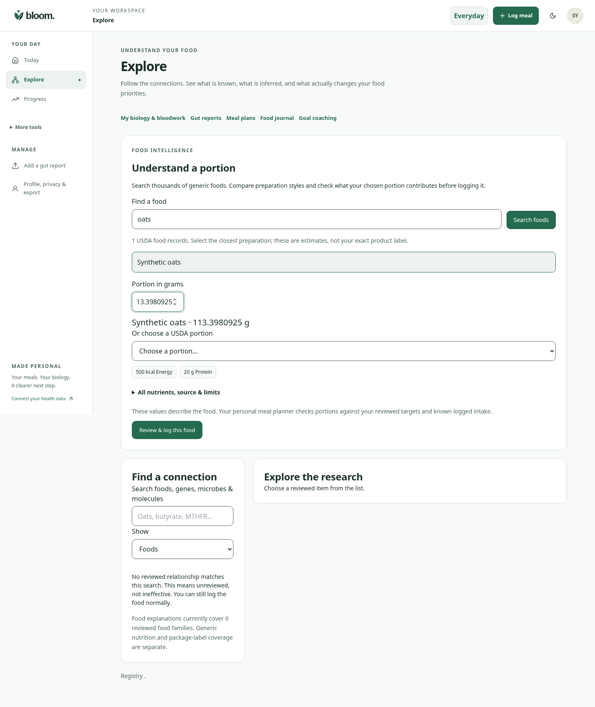](before-explore-portion-1440-light.png) | [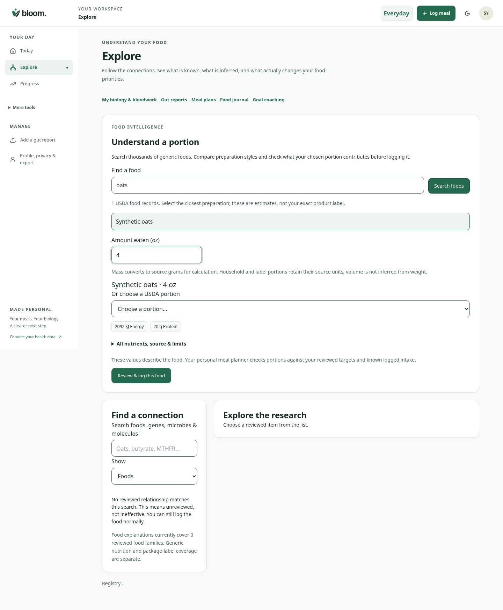](after-explore-portion-1440-light.png) |
| today-1440-dark Saved kJ preference applies: 500 kcal now displays as 2092 kJ; stored intake is unchanged. |  | [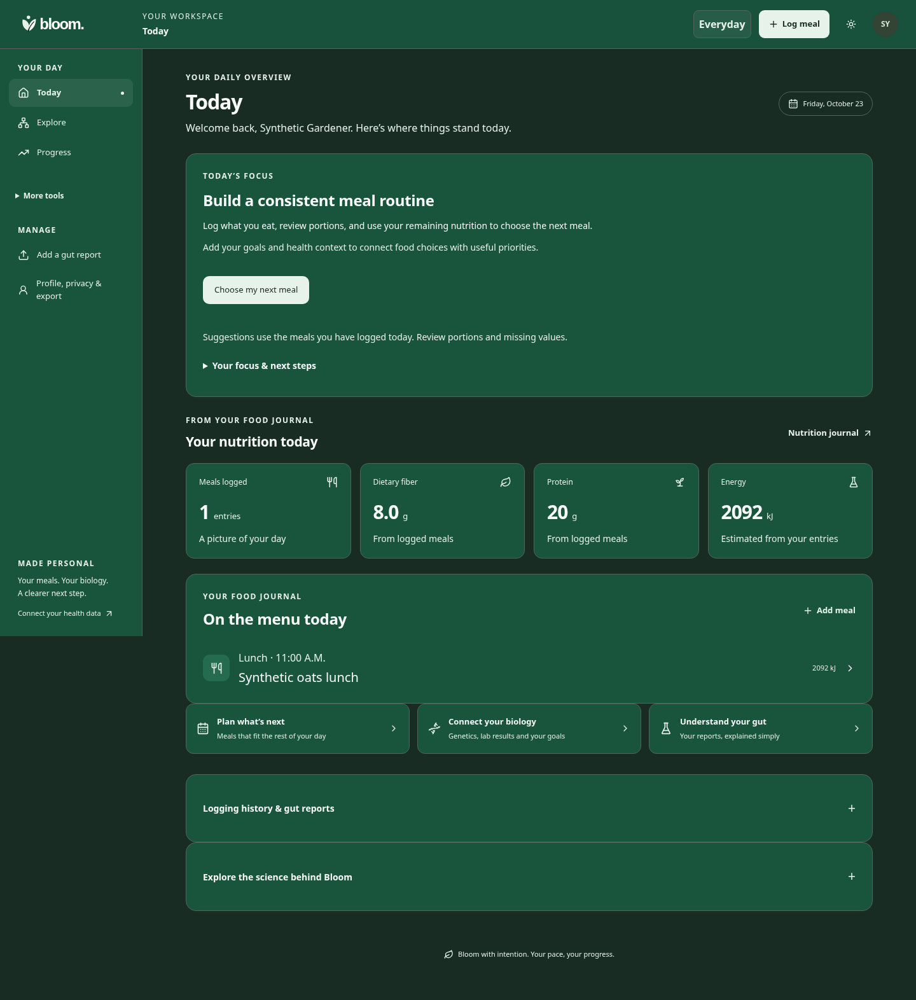](after-today-1440-dark.png) |
| nutrition-1440-dark Saved kJ preference applies: 500 kcal now displays as 2092 kJ; stored intake is unchanged. | [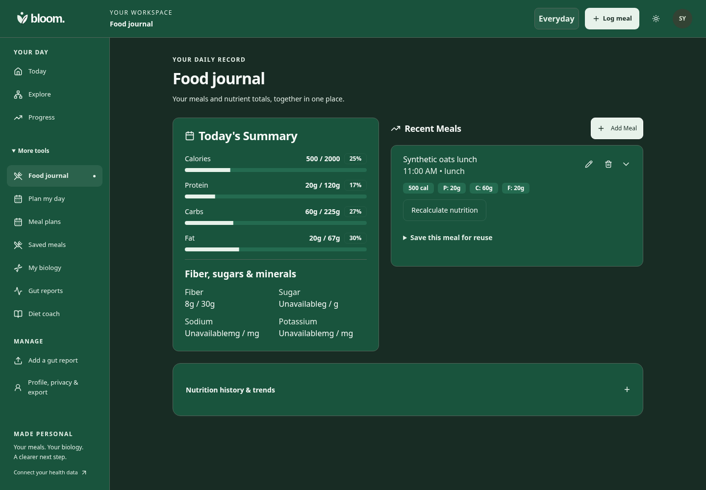](before-nutrition-1440-dark.png) |  |
| explore-portion-1440-dark The same 113.3980925 g portion is entered as 4 oz; source serving facts retain grams. | [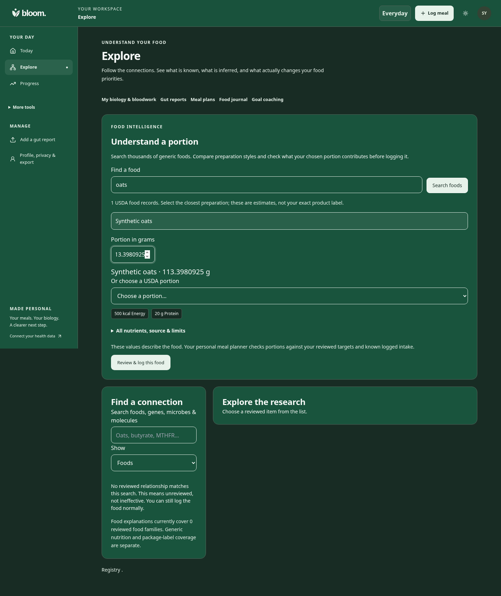](before-explore-portion-1440-dark.png) | [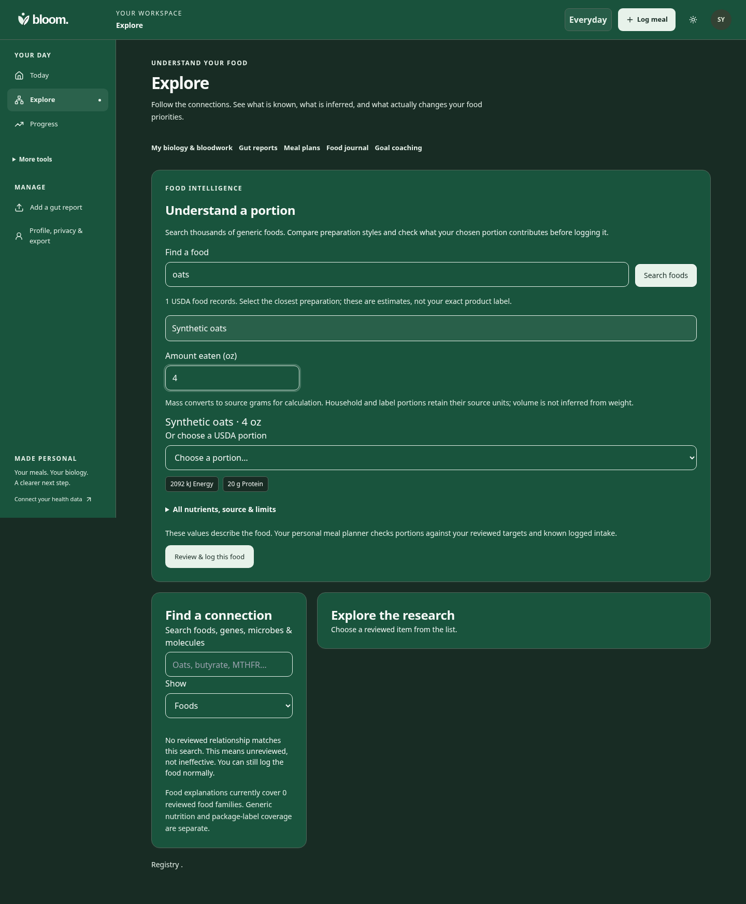](after-explore-portion-1440-dark.png) |
| today-partial-390-light Incomplete estimates now lead to journal review. | [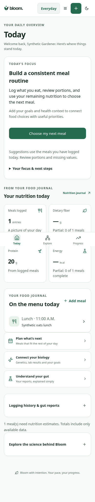](before-today-partial-390-light.png) | [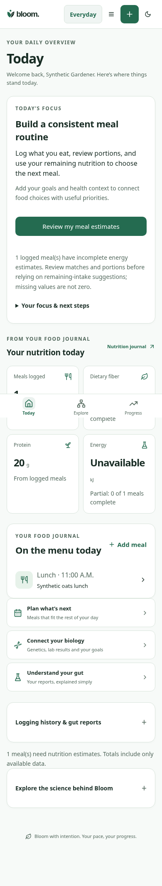](after-today-partial-390-light.png) |
| today-unavailable-390-light A journal outage no longer implies no food was logged. |  | [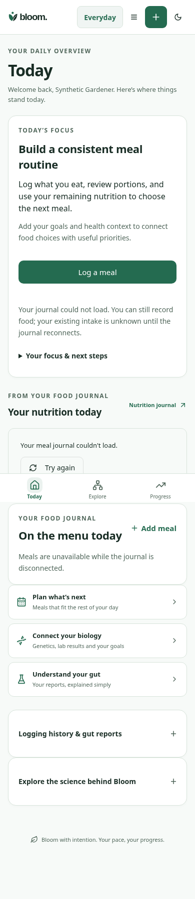](after-today-unavailable-390-light.png) |
