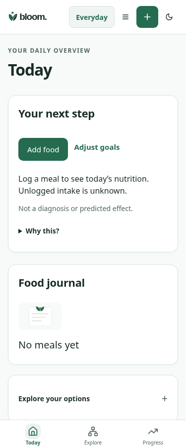
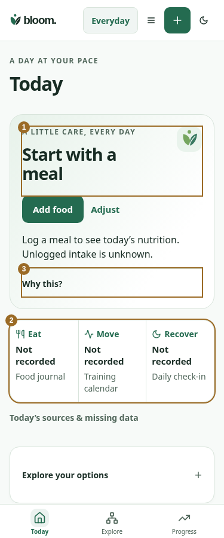
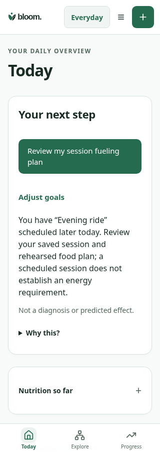
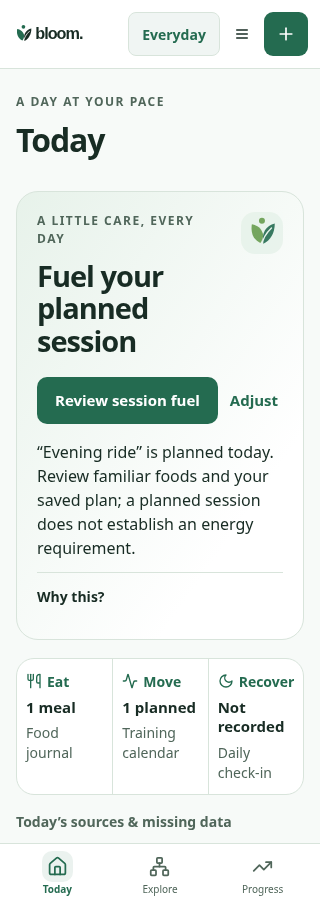

# Today companion — actual Everyday app review

Implementation review, not Branding/User Testing acceptance. Synthetic account/data; no real account, device, diagnosis or source-provider acceptance is implied.

Matched baseline: `aa22265c415f3ee702b06f93f70314bacd29856c`. The harness loads the exact pre-change Dashboard, TodayFocus, brand CSS and action helper through a Vite source override. Other application code and fixtures are shared. Browser: Chromium, America/Regina, 2026-10-25 noon local, reduced motion; 320/375/390/1280 ×900. Theme transitions settle before capture. Unmarked originals remain in `before`/`after`.

| Before | After |
| --- | --- |
|  |  |
|  |  |

1. One action-led hero with the existing Bloom mark and canonical Add Food/goal adjustment. No second Today model or score.
2. Compact Eat/Move/Recover observations link to actual source workflows. Missing data remains unrecorded; planned sessions stay distinct from completed activity; sleep is dated/self-reported and zero is retained. The duplicate empty-journal panel is removed.
3. Supporting rationale and references remain under Why this? Material missingness remains visible in the main reason. Pending/failed context refresh retracts cached personal goal/session guidance.

The six visual fixtures are empty, partial nutrition, recorded meal/upcoming session, a recorded check-in without a session, delayed journal and failed journal/context. Each has all four widths plus dark375. `no-session` is **not evidence of a planned rest day**. Existing contracts do not represent an explicit planned rest date; the interface states this distinction. Source details reveal date, limits and correction links without invented denominators or readiness.

Functional checks additionally hold/fail/retry actual query refreshes, preserve recorded zero sleep, open canonical goal editing and Add Food. The existing task-first journey separately verifies explicit goal save updates Today, keyboard activation, partial estimates, empty onboarding, failures and320×500 effective-zoom layout without replacing its historical gallery. These synthetic/browser checks do not establish physical Safari/VoiceOver, actual browser zoom or human task-time/comprehension acceptance.

Scope remaining: Athlete's separate home, explicit planned-rest/Skip persistence within approved source contracts, final asset-package integration, native/browser-device accessibility and independent Branding/User Testing review. The referenced redesign ZIP is absent from this workspace; this implementation uses existing approved Bloom assets/tokens and the written Architect acceptance.

Reproduce: `BLOOM_PLAYWRIGHT_MODULE=/opt/codex/cua_node/lib/node_modules/playwright BLOOM_CHROMIUM_EXECUTABLE=/usr/bin/chromium node --import tsx scripts/qa/today-companion-journey.mjs before` (then `after`). Evidence results are in each phase's JSON. No real user data is modified.
