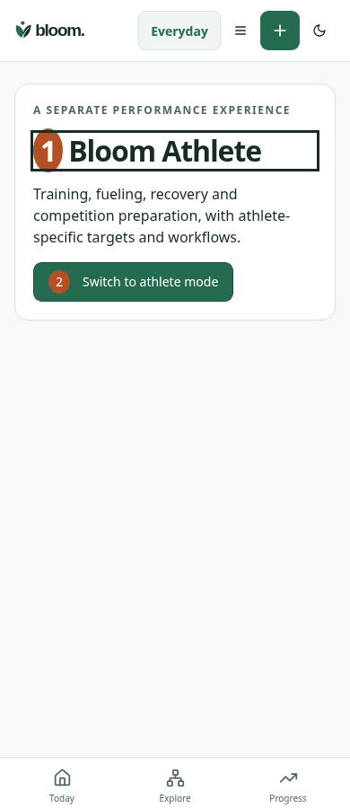
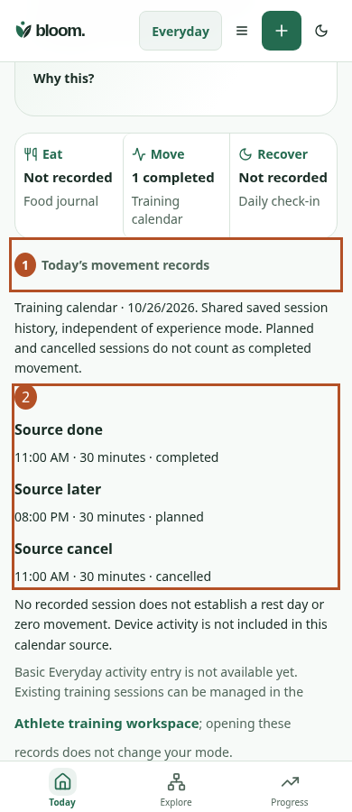

# Today Move: source access without a mode switch

Same synthetic account, records, local date (2026-10-26), America/Regina timezone,390×900 light viewport, reduced motion; activate Move by keyboard in the actual React app. Prior source0f265410e5747a884be760eddae57df19f9ce7c2 loaded through Vite for the before state; current source for after. This compares the outcome of the same action: the prior mode gate versus the new dated source disclosure. After scrolls to the focused disclosure.

| Before | After |
| --- | --- |
|  |  |

1. Before: Move opens the Athlete page instead of the source; reviewing records requires a mode switch. After: Move opens and focuses the source disclosure on Today.
2. Before: the primary action changes mode. After: exact saved titles, times, durations and completed/planned/cancelled states are readable without writes or a mode change.

Unmarked originals: [before](before.png), [after](after.png). No new activity-entry feature, native permission, calorie/readiness calculation or independent acceptance is implied.

Reproduce with scripts/qa/today-movement-source-journey.mjs; BLOOM_MOVEMENT_BASELINE selects prior source and BLOOM_MOVEMENT_EVIDENCE selects optional output directory. Additional automated cases: pending/error source withdrawal and retry; cancelled-only/absent; local-midnight exclusion;320/390/1280 overflow and touch size; separate account reload; no mutation requests. Synthetic intercepted HTTP storage, not a live account or physical-device test.
