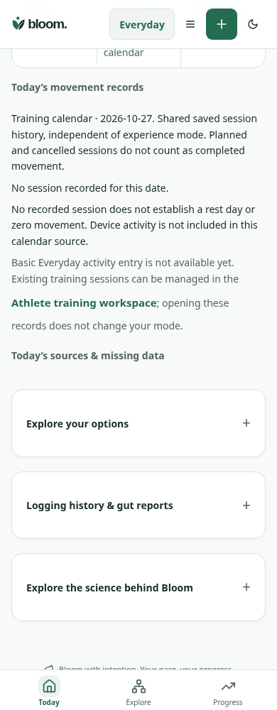
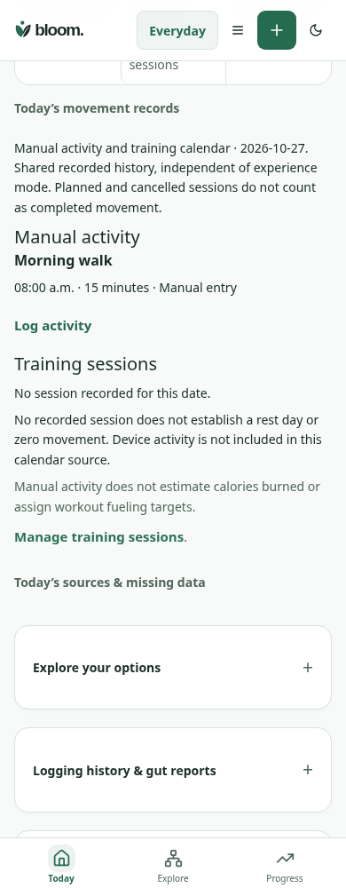

# Everyday activity — core journey B

Matched390×1000 light Today Move, same synthetic owner/date and encrypted Morning walk record. Before loads TodayStatus from2042b61 (manual entry unavailable); after displays that existing record and offers Log activity. Original PNGs are unannotated.

| Before | After |
| --- | --- |
|  |  |

1. Today Move reads manual activity from the existing encrypted workspace, separately from training sessions. A normal Everyday user can log activity without Athlete setup.
2. [Activity log](activity-screen.png) captures title, date/time and duration, with optional effort/notes. It supports correction, explicit deletion and exact retry after an uncertain save.
3. Canonical refetch updates Today and dated Progress. No calorie-burn estimate, invented RPE/weather or Athlete fueling target is derived.

`node --import tsx scripts/qa/activity-log-journey.mjs` exercises actual React, Express and encrypted PostgreSQL-compatible storage: Today→log→lost committed response/exact key+body retry→correct duration→Today→Progress→delete. It preserves the original instant/zone, keeps other-owner data private and verifies320px keyboard/no-overflow. The existing Today movement-source regression also passes. Baseline capture uses BLOOM_ACTIVITY_BASELINE=1. Browser paths are environment-configurable. Full396 tests, types/build/inventories pass locally; exact Actions/Render publication is tracked separately. These are synthetic engineering checks, not native/device/human or independent specialist acceptance.
