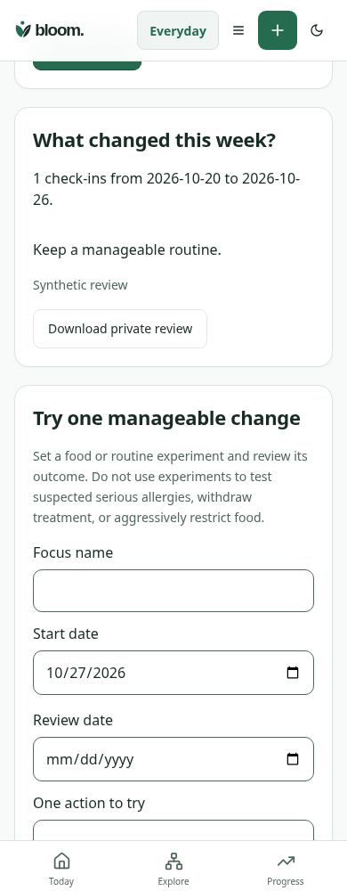
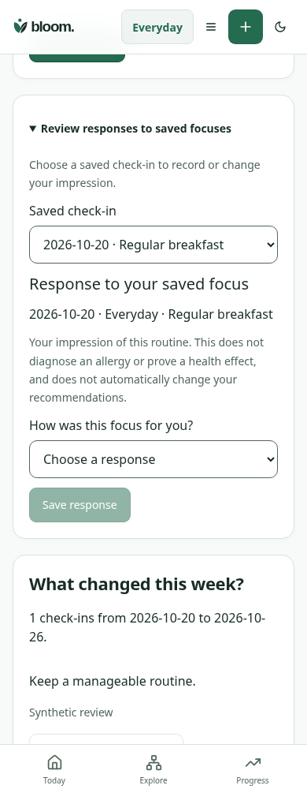

# Saved-focus responses — synthetic rendered evidence

Matched 390×1000 light-theme Weekly Review, same synthetic owner and saved October20 Regular breakfast check-in, same scroll anchor below the check-in form. Before loads WeeklyReview from a625c32; after expands the new optional disclosure and selects that unchanged check-in. Originals are unannotated.

| Before | After |
| --- | --- |
|  |  |

1. Optional disclosure adds a response workflow without adding a competing home panel or changing the numerical check-in form.
2. A selected saved check-in is checked against the encrypted owner source before response controls appear; no response is preselected.
3. Original subjective context stays visible after later focus edits; clear, conflict review and exact retry are explicit actions. The impression does not drive allergy or clinical ranking.

`node --import tsx scripts/qa/focus-feedback-journey.mjs` uses the actual React app, Express action/reader and encrypted PGlite storage. It covers a lost committed response, malformed successful acknowledgment, exact key/body retry, stale-focus409/current-source review, preservation of newer ratings/notes, clear, failed source refresh withholding controls, other-owner isolation and 320px keyboard/no-horizontal-overflow. `BLOOM_FEEDBACK_BASELINE=1` captures the baseline. Browser module/executable are environment-configurable. Both runs passed. These are synthetic engineering checks, not independent design, native-device or human acceptance.
