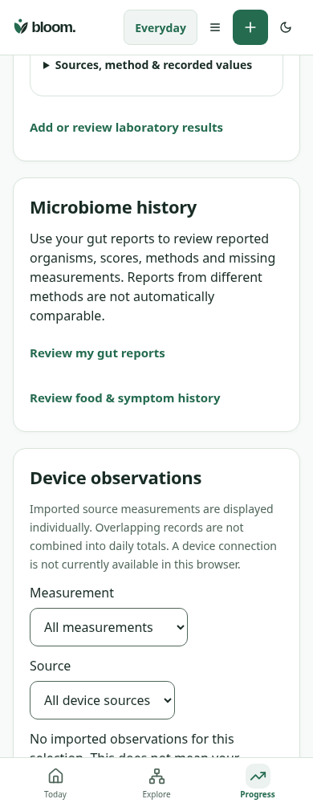
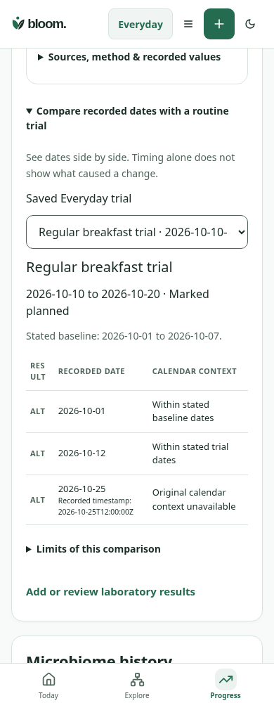

# LAB-05 recorded trial/calendar context

Matched390×1000 light Progress, same synthetic owner/records and scroll anchor at the last bloodwork card's lower edge. Before loads Progress from3760580; after opens the new optional disclosure and selects the same saved planned breakfast trial. Original PNGs are unannotated.

| Before | After |
| --- | --- |
|  |  |

1. Optional calendar view reuses existing trial and active confirmed lab records. No plan, dose or laboratory result is created or changed.
2. Explicit baseline/trial boundaries place recorded dates; corrected/entered calendar context takes precedence over UTC dates. Legacy missing calendar context stays unknown.
3. Status is self-reported; overlap is not an effect or comparability claim. Adherence, retrospective entry, source/method and confounding limits remain available on demand.

Pure boundary/correction/offset/unknown/invalid/duplicate tests and existing source-history/science contracts pass (7 tests); types/build/inventories pass. The actual React/Express/encrypted-PGlite journey verifies owner/mode isolation, zero values, unconfirmed-unit exclusion, unknown legacy dates, source failure withdrawal/retry, keyboard320px and no mutation. Reproduce with `node --import tsx scripts/qa/lab-routine-timing-journey.mjs`; optional BLOOM_TIMING_BASELINE=1 captures baseline. Browser paths are environment-configurable. Initial harness-only failures (storage signature, pending parser bucket, missing device-source fixture) were corrected before the final passing runs. Synthetic evidence does not constitute clinical, independent design, device or human acceptance.
